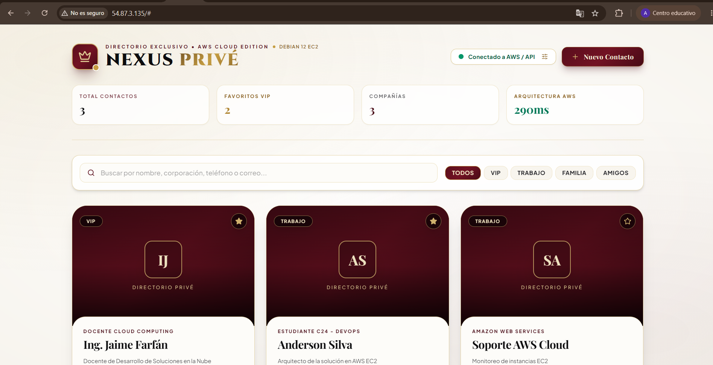
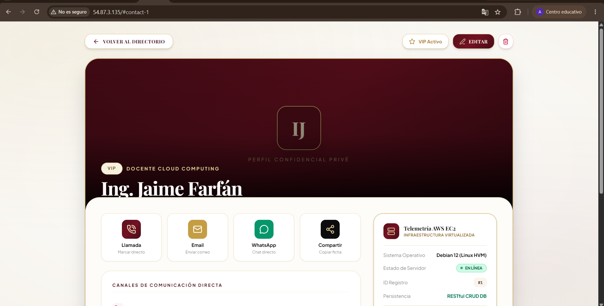
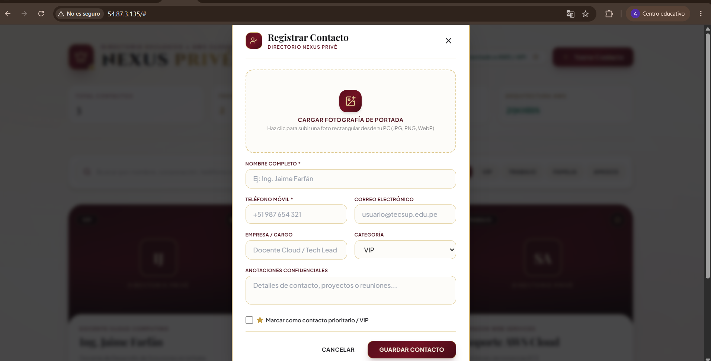

# ⚜️ Nexus Privé - Cloud Contacts Management System

> **Laboratorio 11: Virtualización en AWS (EC2 + Linux Ubuntu/Debian + Node.js + PM2)**  
> **Curso:** Desarrollo de Soluciones en la Nube | **Profesor:** Jaime Farfán | **Institución:** Tecsup C24


---

## 📸 Galería de Evidencias y Capturas

### 1. Vista Principal del Directorio (Estilo Bento Card)


### 2. Vista de Detalle de Contacto (Página Completa en SPA)


### 3. Servidor y Proceso Activo en AWS EC2 (PM2 Online 24/7)


---

## 🏗️ Arquitectura de la Solución Virtualizada

```
[ Usuario en Internet ]
           │
           ▼ (HTTP - Puerto 80)
 [ AWS Security Group ] (Reglas: SSH:22, HTTP:80)
           │
           ▼
[ Instancia AWS EC2 ] (Ubuntu 24.04 LTS / Familia Debian)
           │
           ▼ (Gestor de Procesos 24/7)
      [ PM2 Daemon ]
           │
           ▼
    [ Node.js / Express ] (server.js en Puerto 80)
           │
           ├─► /api/contacts (CRUD RESTful: GET, POST, PUT, DELETE)
           ├─► /health       (Healthcheck del servidor en la nube)
           └─► /frontend     (SPA HTML5 + TailwindCSS + Lucide Icons)
```

---

## ✨ Características Principales

- **CRUD Completo:** Creación, lectura, edición y eliminación de contactos con soporte para subida de imágenes reales (JPEG/PNG con compresión en Canvas).
- **Diseño Editorial de Lujo:** Estética *Privé* en tonos marfil, borgoña y acentos dorados con tipografías de alta gama (`Cinzel` y `Playfair Display`).
- **Navegación SPA Completa:** Vista de detalle dedicada en pantalla completa con historial de navegador (`hashchange`), bitácora confidencial y telemetría de nube.
- **Despliegue Continuo con Git:** Clonado y configurado directamente desde el repositorio de GitHub en la instancia virtualizada de AWS.
- **Alta Disponibilidad:** Configurado como servicio de producción con **PM2** con arranque automático en caso de reinicio de la máquina (`pm2 startup` y `pm2 save`).

---

## 🚀 Despliegue Rápido en una Instancia EC2

```bash
# 1. Instalar entorno de ejecución
curl -fsSL https://deb.nodesource.com/setup_20.x | sudo -E bash -
sudo apt update && sudo apt install -y nodejs git
sudo npm install -g pm2

# 2. Clonar repositorio y dependencias
git clone https://github.com/rivera-anderson/labnube11.git app
cd app
npm install

# 3. Iniciar servicio en producción en puerto 80
sudo PORT=80 pm2 start server.js --name "nexus"
sudo pm2 startup
sudo pm2 save
```

---

## 📝 Conclusiones Técnicas del Laboratorio

1. **Aprovisionamiento y Aislamiento:** La virtualización mediante AWS EC2 permite levantar sistemas operativos completos bajo demanda con separación de recursos garantizada mediante hardware virtualizado.
2. **Administración Liviana:** El uso de entornos Linux (familia Debian/Ubuntu) administrados mediante SSH optimiza radicalmente el consumo de RAM y ancho de banda en comparación con escritorios gráficos RDP.
3. **Control Perimetral:** La disponibilidad del servicio hacia el exterior depende estrictamente de las reglas del Grupo de Seguridad (Security Group), requiriendo abrir explícitamente el puerto `80/TCP`.
4. **Resiliencia de Procesos:** La integración de PM2 garantiza la continuidad operativa 24/7 de la aplicación en la nube sin depender de terminales activas.
